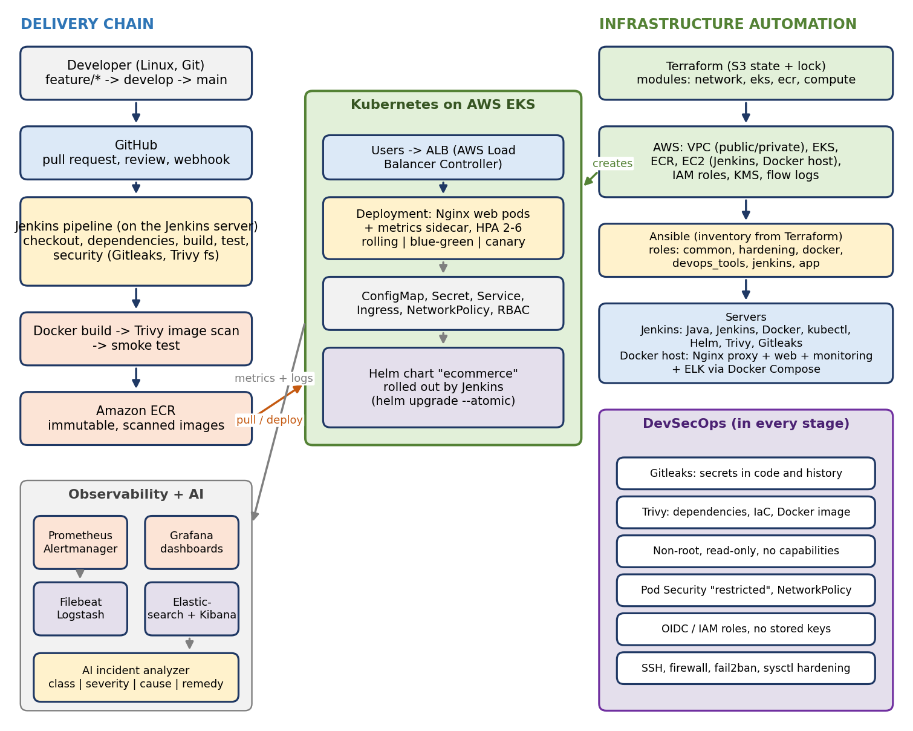

# Architecture

## Layers

| Layer | Folder | Technology | Purpose |
|---|---|---|---|
| Source control | `.github/`, `docs/git-workflow.md` | Git, GitHub | One source of truth. Branches `main`, `develop`, `feature/*`, pull requests, review |
| Linux environment | `docs/linux-environment.md`, `scripts/setup.sh` | Linux | Foundation for Docker, Jenkins, Kubernetes tools |
| Automation | `scripts/` | Bash | Repeatable setup, deploy, health check, backup, cleanup |
| Web server | `docker/nginx/` | Nginx | Static serving, reverse proxy, JSON access logs, `/health` |
| Containers | `docker/` | Docker, Compose | One runtime everywhere: laptop, server, cluster |
| CI/CD | `jenkins/`, `.github/workflows/` | Jenkins, GitHub Actions | Build, test, scan, push, deploy, verify |
| Infrastructure | `terraform/` | Terraform | VPC, EKS, ECR, EC2, IAM, KMS from code |
| Configuration | `ansible/` | Ansible | Hardening, Docker, Jenkins, the application server |
| Orchestration | `kubernetes/` | Kubernetes (EKS), AWS Load Balancer Controller | Namespace, Deployment, Service, ConfigMap, Secret, Ingress (ALB), HPA, rolling updates |
| Packaging | `helm/ecommerce/` | Helm | The same objects as one versioned, configurable release |
| Monitoring | `monitoring/` | Prometheus, Alertmanager, Grafana | Metrics, alerts, dashboards |
| Logging | `logging/elk/` | Filebeat, Logstash, Elasticsearch, Kibana | Central log search |
| Security | `security/` | Gitleaks, Trivy, hardening scripts | Checks in every stage |
| AI | `ai/incident-analysis/` | Python (+ optional LLM) | Error class, severity, cause, remediation |

## The two runtime modes

1. **Single server (Docker Compose)** on the EC2 "app server" or any Linux machine:
   `User -> proxy (Nginx) -> web (Nginx + static site)`, plus optional Prometheus/Grafana and ELK containers.
2. **Kubernetes (EKS)**: `User -> ALB (AWS Load Balancer Controller) -> pods (+ exporter sidecar)`,
   plus kube-prometheus-stack and the ELK stack in their own namespaces.

Both use the **same image** and the **same Nginx configuration** (`docker/nginx/default.conf` is the single
source; `scripts/sync-config.sh` copies it into the Kubernetes ConfigMap and the Helm chart).

## Delivery flow

`push -> Jenkins -> lint/test -> Gitleaks + Trivy fs -> docker build -> smoke test -> Trivy image scan ->
push to ECR -> helm upgrade (rolling | blue-green | canary) -> health check -> Slack`.
If a stage fails, the AI analyzer reads the pipeline log and writes `reports/incident-report.md`.

## Network and security design (AWS)

* VPC with public subnets (load balancers, NAT, Jenkins and Docker host) and private subnets (worker nodes).
* Nodes have no public address; they reach the internet through NAT.
* The Kubernetes API is reachable only from `eks_public_access_cidrs`; Jenkins and SSH only from `admin_cidrs`.
* No access keys anywhere: EC2 instance roles for Jenkins and the Docker host, OIDC for GitHub Actions,
  an OIDC provider + IRSA role for the EBS CSI driver.
* Kubernetes Secrets are envelope-encrypted with a KMS key; EBS volumes are encrypted; IMDSv2 is required.
* Pods run non-root with a read-only file system, all capabilities dropped, seccomp `RuntimeDefault`;
  the namespace enforces the Pod Security `restricted` profile; a default-deny NetworkPolicy allows only the
  ALB (VPC addresses) and Prometheus.

## Design decisions

| Decision | Reason |
|---|---|
| `nginx-unprivileged` image on port 8080 | Runs as a normal user, so no root and no extra capabilities |
| Immutable image tags `<build>-<commit>` | A tag always means one exact image; rollback is exact |
| Helm release owns the live Deployment; blue-green/canary are scripts | Helm gives versioned releases and `--atomic` rollback; the scripts handle the short-lived second version |
| AWS Load Balancer Controller (ALB) instead of ingress-nginx | ingress-nginx was retired on 24 March 2026 and gets no security patches. The AWS controller is maintained by AWS, sends traffic directly to pod IPs and supports weighted routing for canary releases |
| Basic auth inside Nginx, not on the load balancer | An ALB cannot do HTTP basic auth, so the pods do it when the optional Secret `nexvion-basic-auth` is mounted |
| Elasticsearch without security in the lab | Bound to localhost (Compose) or a NetworkPolicy (Kubernetes). **Enable `xpack.security` before real use** |
| Terraform writes the Ansible inventory | No copy-paste of IP addresses between the two tools |
